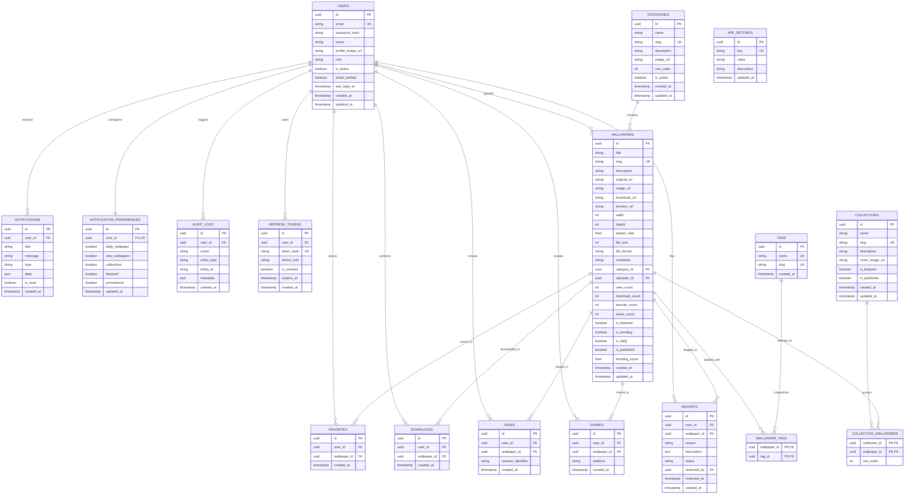

# WALLPAPERS_8K1 — ARCHITECTURAL BLUEPRINT & MASTER SPECIFICATION

## A. Current Project Analysis

- **Workspace Path:** `e:\Wallpapers_8k1`
- **Initial State:** Empty directory (`0` files, clean slate).
- **Host Environment Analysis:**
  - **OS:** Windows 10/11 (PowerShell environment)
  - **Python:** Python 3.11.9 installed and functional (`AppData\Local\Programs\Python\Python311`)
  - **Node.js:** v26.4.0 installed with npm 11.17.0
  - **Git:** Installed (`C:\Program Files\Git\cmd\git.exe`)
  - **Flutter / Dart:** Flutter CLI is not currently configured in the user's system PATH. The mobile project will be strictly scaffolded using production-standard Dart/Flutter patterns, compliant with Flutter 3.x+ / Dart 3.x specifications, ready for immediate compilation on any development machine or CI/CD container with Flutter installed.
  - **PostgreSQL / Docker:** Docker CLI is not detected in PATH. Local development will support both PostgreSQL (via standard connection URI or service) and a zero-dependency local SQLite async compatibility mode for lightweight local integration testing, while maintaining PostgreSQL as the primary production target.
- **Disk Availability:**
  - Drive `E:` free space: ~12.25 GB
  - Drive `C:` free space: ~24.70 GB

---

## B. Proposed System Architecture

Wallpapers_8k1 is built around a decoupled, layered, production-grade micro-modular architecture:

```
┌────────────────────────────────┐       ┌────────────────────────────────┐
│   Flutter Mobile App (Android) │       │   Admin Web Panel (React/TS)   │
│  - BLoC/Cubit State Management │       │  - Vite + React 18 + TS        │
│  - Dio API Client + Interceptor│       │  - TanStack Query + Tailwind   │
│  - Hive/SharedPrefs Cache      │       │  - Role-based Protected Routes │
└───────────────┬────────────────┘       └───────────────┬────────────────┘
                │                                        │
                │ HTTPS / JSON REST API                  │ HTTPS / JSON REST API
                │ (Bearer JWT / Refresh)                 │ (Admin RBAC Token)
                ▼                                        ▼
┌─────────────────────────────────────────────────────────────────────────┐
│                      FastAPI Application Gateway                        │
│   - Versioned Routes (/api/v1/...)                                      │
│   - CORS, Trusted Host, Security Headers & Rate Limiting Middleware    │
│   - Standardized Error Handling & RFC-7807 Problem Details              │
│   - Pydantic v2 Request Validation & Response Serialization             │
└────────────────────────────────────┬────────────────────────────────────┘
                                     │
                 ┌───────────────────┴───────────────────┐
                 ▼                                       ▼
┌─────────────────────────────────┐     ┌─────────────────────────────────┐
│          Service Layer          │     │     Async Task / Worker Layer   │
│  - AuthService                  │     │  - Image Processing Pipeline    │
│  - WallpaperService             │     │  - Variant Generator (Pillow)   │
│  - CategoryService              │     │  - Daily Wallpaper Selector     │
│  - TrendingAlgorithmService     │     │  - Notification Dispatcher      │
│  - DownloadTrackingService      │     └────────────────┬────────────────┘
│  - AnalyticsService             │                      │
└────────────────┬────────────────┘                      │
                 ▼                                       │
┌─────────────────────────────────┐                      │
│     Repository / Data Layer     │                      │
│  - SQLAlchemy 2.0 Async Session │                      │
│  - Parameterized Queries        │                      │
│  - Unit of Work Pattern         │                      │
└────────────────┬────────────────┘                      │
                 │                                       │
                 ▼                                       ▼
┌─────────────────────────────────┐     ┌─────────────────────────────────┐
│      PostgreSQL 15+ Database    │     │      Storage Provider (Layer)   │
│  - Normalized Relational Tables │     │  - Abstract StorageProvider     │
│  - B-tree & Trigram Indexes     │     │  - LocalFileSystemProvider      │
│  - Foreign Key Constraints      │     │  - S3CompatibleStorageProvider  │
│  - Alembic Migration Revisions  │     │  - Multi-tier: Original, Preview│
│                                 │     │    Optimized, Thumbnail         │
└─────────────────────────────────┘     └─────────────────────────────────┘
```

---

## C. Complete Folder Structure

```
/Wallpapers_8k1
├── .env.example
├── .gitignore
├── docker-compose.yml
├── README.md
├── docs/
│   ├── ARCHITECTURE.md
│   ├── API_SPECIFICATION.md
│   └── DEPLOYMENT.md
├── alembic/
│   ├── env.py
│   ├── script.py.mako
│   └── versions/
├── backend/
│   ├── Dockerfile
│   ├── pyproject.toml
│   ├── requirements.txt
│   └── app/
│       ├── __init__.py
│       ├── main.py
│       ├── core/
│       │   ├── config.py
│       │   ├── security.py
│       │   ├── logging.py
│       │   ├── exceptions.py
│       │   └── constants.py
│       ├── db/
│       │   ├── session.py
│       │   └── base.py
│       ├── models/
│       │   ├── user.py
│       │   ├── wallpaper.py
│       │   ├── category.py
│       │   ├── tag.py
│       │   ├── collection.py
│       │   ├── interaction.py
│       │   ├── report.py
│       │   ├── notification.py
│       │   └── audit.py
│       ├── schemas/
│       │   ├── user.py
│       │   ├── token.py
│       │   ├── wallpaper.py
│       │   ├── category.py
│       │   ├── collection.py
│       │   ├── interaction.py
│       │   ├── report.py
│       │   ├── notification.py
│       │   ├── analytics.py
│       │   └── common.py
│       ├── repositories/
│       │   ├── base.py
│       │   ├── user_repository.py
│       │   ├── wallpaper_repository.py
│       │   ├── category_repository.py
│       │   ├── collection_repository.py
│       │   ├── interaction_repository.py
│       │   ├── report_repository.py
│       │   └── audit_repository.py
│       ├── services/
│       │   ├── auth_service.py
│       │   ├── wallpaper_service.py
│       │   ├── category_service.py
│       │   ├── collection_service.py
│       │   ├── trending_service.py
│       │   ├── analytics_service.py
│       │   ├── report_service.py
│       │   └── notification_service.py
│       ├── storage/
│       │   ├── base.py
│       │   ├── local.py
│       │   ├── s3.py
│       │   └── image_processor.py
│       ├── middleware/
│       │   ├── error_handler.py
│       │   ├── logging_middleware.py
│       │   └── rate_limiter.py
│       ├── api/
│       │   ├── deps.py
│       │   └── v1/
│       │       ├── router.py
│       │       ├── endpoints/
│       │       │   ├── auth.py
│       │       │   ├── wallpapers.py
│       │       │   ├── categories.py
│       │       │   ├── collections.py
│       │       │   ├── search.py
│       │       │   ├── interactions.py
│       │       │   ├── profile.py
│       │       │   ├── notifications.py
│       │       │   └── admin.py
│       └── tests/
│           ├── conftest.py
│           ├── test_auth.py
│           ├── test_wallpapers.py
│           ├── test_categories.py
│           ├── test_interactions.py
│           └── test_admin.py
├── admin/
│   ├── Dockerfile
│   ├── package.json
│   ├── tsconfig.json
│   ├── vite.config.ts
│   ├── index.html
│   └── src/
│       ├── main.tsx
│       ├── App.tsx
│       ├── assets/
│       ├── components/
│       │   ├── common/
│       │   ├── layout/
│       │   │   ├── Sidebar.tsx
│       │   │   ├── Topbar.tsx
│       │   │   └── AdminLayout.tsx
│       │   └── ui/
│       ├── pages/
│       │   ├── Login.tsx
│       │   ├── Dashboard.tsx
│       │   ├── Wallpapers.tsx
│       │   ├── WallpaperUpload.tsx
│       │   ├── Categories.tsx
│       │   ├── Collections.tsx
│       │   ├── Users.tsx
│       │   ├── Reports.tsx
│       │   ├── Analytics.tsx
│       │   └── Settings.tsx
│       ├── services/
│       │   ├── api.ts
│       │   ├── authService.ts
│       │   ├── wallpaperService.ts
│       │   ├── categoryService.ts
│       │   └── adminService.ts
│       ├── hooks/
│       │   └── useAuth.ts
│       ├── store/
│       │   └── authStore.ts
│       └── types/
│           └── index.ts
└── mobile/
    ├── pubspec.yaml
    ├── analysis_options.yaml
    ├── android/
    │   ├── app/
    │   │   ├── build.gradle
    │   │   └── src/main/AndroidManifest.xml
    │   ├── build.gradle
    │   └── settings.gradle
    ├── assets/
    │   ├── icons/
    │   └── images/
    └── lib/
        ├── main.dart
        ├── core/
        │   ├── config/
        │   │   ├── env.dart
        │   │   └── app_config.dart
        │   ├── constants/
        │   │   ├── api_endpoints.dart
        │   │   └── app_constants.dart
        │   ├── error/
        │   │   ├── exceptions.dart
        │   │   └── failures.dart
        │   ├── network/
        │   │   ├── api_client.dart
        │   │   └── auth_interceptor.dart
        │   ├── storage/
        │   │   └── secure_storage_service.dart
        │   ├── theme/
        │   │   ├── app_colors.dart
        │   │   ├── app_typography.dart
        │   │   ├── app_theme.dart
        │   │   └── theme_cubit.dart
        │   └── router/
        │       └── app_router.dart
        ├── shared/
        │   └── widgets/
        │       ├── wallpaper_card.dart
        │       ├── wallpaper_grid.dart
        │       ├── custom_app_bar.dart
        │       ├── state_views.dart
        │       └── shimmer_loader.dart
        └── features/
            ├── auth/
            │   ├── data/
            │   ├── domain/
            │   └── presentation/
            ├── home/
            │   ├── data/
            │   ├── domain/
            │   └── presentation/
            ├── wallpapers/
            │   ├── data/
            │   ├── domain/
            │   └── presentation/
            ├── categories/
            │   ├── data/
            │   ├── domain/
            │   └── presentation/
            ├── collections/
            │   ├── data/
            │   ├── domain/
            │   └── presentation/
            ├── search/
            │   ├── data/
            │   ├── domain/
            │   └── presentation/
            ├── favorites/
            │   ├── data/
            │   ├── domain/
            │   └── presentation/
            ├── downloads/
            │   ├── data/
            │   ├── domain/
            │   └── presentation/
            ├── profile/
            │   ├── data/
            │   ├── domain/
            │   └── presentation/
            └── settings/
                ├── data/
                ├── domain/
                └── presentation/
```

---

## D. Database ER Model



---

## E. Database Table Plan & Indexes

1. **`users`**
   - Indexes: `ix_users_email` (UNIQUE), `ix_users_role`, `ix_users_created_at`.
2. **`wallpapers`**
   - Indexes: `ix_wallpapers_slug` (UNIQUE), `ix_wallpapers_category_id`, `ix_wallpapers_is_published`, `ix_wallpapers_is_trending`, `ix_wallpapers_is_featured`, `ix_wallpapers_is_daily`, `ix_wallpapers_created_at`, `ix_wallpapers_download_count`, `ix_wallpapers_view_count`, `ix_wallpapers_trending_score`.
   - Trigram/Text Search Index: GIN index on `to_tsvector('english', title || ' ' || coalesce(description, ''))`.
3. **`categories`**
   - Indexes: `ix_categories_slug` (UNIQUE), `ix_categories_sort_order`, `ix_categories_is_active`.
4. **`tags`**
   - Indexes: `ix_tags_slug` (UNIQUE), `ix_tags_name` (UNIQUE).
5. **`wallpaper_tags`**
   - Composite PK: `(wallpaper_id, tag_id)`.
6. **`collections`**
   - Indexes: `ix_collections_slug` (UNIQUE), `ix_collections_is_published`, `ix_collections_is_featured`.
7. **`collection_wallpapers`**
   - Composite PK: `(collection_id, wallpaper_id)`. Index on `sort_order`.
8. **`favorites`**
   - Unique Constraint: `(user_id, wallpaper_id)`.
   - Indexes: `ix_favorites_user_id`, `ix_favorites_wallpaper_id`, `ix_favorites_created_at`.
9. **`downloads`**
   - Indexes: `ix_downloads_user_id`, `ix_downloads_wallpaper_id`, `ix_downloads_created_at`.
10. **`views`**
    - Indexes: `ix_views_wallpaper_id`, `ix_views_session_ident`, `ix_views_created_at`.
11. **`shares`**
    - Indexes: `ix_shares_wallpaper_id`, `ix_shares_platform`, `ix_shares_created_at`.
12. **`reports`**
    - Indexes: `ix_reports_wallpaper_id`, `ix_reports_status`, `ix_reports_created_at`.
13. **`notifications`**
    - Indexes: `ix_notifications_user_id`, `ix_notifications_is_read`, `ix_notifications_created_at`.
14. **`notification_preferences`**
    - Unique Constraint: `user_id`.
15. **`app_settings`**
    - Index: `ix_app_settings_key` (UNIQUE).
16. **`audit_logs`**
    - Indexes: `ix_audit_logs_user_id`, `ix_audit_logs_entity`, `ix_audit_logs_created_at`.
17. **`refresh_tokens`**
    - Indexes: `ix_refresh_tokens_token_hash` (UNIQUE), `ix_refresh_tokens_user_id`, `ix_refresh_tokens_expires_at`.

---

## F. API Architecture

All endpoints reside under `/api/v1/` with consistent envelope format:

### Standardized Success Response
```json
{
  "success": true,
  "data": { ... },
  "message": "Operation successful",
  "meta": {
    "page": 1,
    "limit": 20,
    "total": 142,
    "total_pages": 8
  }
}
```

### Standardized Error Response
```json
{
  "success": false,
  "error": {
    "code": "WALLPAPER_NOT_FOUND",
    "message": "Wallpaper with ID 4f98... does not exist",
    "details": []
  }
}
```

### Endpoint Routing Matrix
- **Auth:**
  - `POST /api/v1/auth/register`
  - `POST /api/v1/auth/login`
  - `POST /api/v1/auth/refresh`
  - `POST /api/v1/auth/logout`
  - `POST /api/v1/auth/forgot-password`
  - `POST /api/v1/auth/reset-password`
  - `GET  /api/v1/auth/me`
- **Wallpapers:**
  - `GET  /api/v1/wallpapers` (filters: `page`, `limit`, `sort`, `category`, `tag`, `resolution`, `featured`, `trending`, `daily`)
  - `GET  /api/v1/wallpapers/{id_or_slug}`
  - `GET  /api/v1/wallpapers/{id}/related`
  - `GET  /api/v1/wallpapers/daily`
- **Categories:**
  - `GET  /api/v1/categories`
  - `GET  /api/v1/categories/{slug}`
  - `GET  /api/v1/categories/{slug}/wallpapers`
- **Collections:**
  - `GET  /api/v1/collections`
  - `GET  /api/v1/collections/{slug}`
- **Search:**
  - `GET  /api/v1/search` (query params: `q`, `category`, `resolution`, `sort`, `page`, `limit`)
- **Interactions (Authenticated/Tracked):**
  - `POST   /api/v1/wallpapers/{id}/favorite`
  - `DELETE /api/v1/wallpapers/{id}/favorite`
  - `GET    /api/v1/users/me/favorites`
  - `POST   /api/v1/wallpapers/{id}/download`
  - `GET    /api/v1/users/me/downloads`
  - `POST   /api/v1/wallpapers/{id}/view`
  - `POST   /api/v1/wallpapers/{id}/share`
  - `POST   /api/v1/wallpapers/{id}/report`
- **User Profile:**
  - `GET  /api/v1/users/me`
  - `PUT  /api/v1/users/me`
  - `PUT  /api/v1/users/me/password`
  - `GET  /api/v1/users/me/notification-preferences`
  - `PUT  /api/v1/users/me/notification-preferences`
- **Notifications:**
  - `GET   /api/v1/notifications`
  - `PATCH /api/v1/notifications/{id}/read`
  - `PATCH /api/v1/notifications/read-all`
- **Admin (Protected: Role >= ADMIN):**
  - `GET    /api/v1/admin/dashboard`
  - `GET    /api/v1/admin/wallpapers`
  - `POST   /api/v1/admin/wallpapers` (multipart image upload + metadata)
  - `GET    /api/v1/admin/wallpapers/{id}`
  - `PUT    /api/v1/admin/wallpapers/{id}`
  - `DELETE /api/v1/admin/wallpapers/{id}`
  - `PATCH  /api/v1/admin/wallpapers/{id}/publish`
  - `PATCH  /api/v1/admin/wallpapers/{id}/feature`
  - `PATCH  /api/v1/admin/wallpapers/{id}/set-daily`
  - `GET    /api/v1/admin/categories`
  - `POST   /api/v1/admin/categories`
  - `PUT    /api/v1/admin/categories/{id}`
  - `DELETE /api/v1/admin/categories/{id}`
  - `GET    /api/v1/admin/collections`
  - `POST   /api/v1/admin/collections`
  - `PUT    /api/v1/admin/collections/{id}`
  - `DELETE /api/v1/admin/collections/{id}`
  - `GET    /api/v1/admin/users`
  - `PATCH  /api/v1/admin/users/{id}/status`
  - `PATCH  /api/v1/admin/users/{id}/role` (SUPER_ADMIN only)
  - `GET    /api/v1/admin/reports`
  - `PATCH  /api/v1/admin/reports/{id}/resolve`
  - `GET    /api/v1/admin/analytics`
  - `GET    /api/v1/admin/settings`
  - `PUT    /api/v1/admin/settings`
  - `GET    /api/v1/admin/audit-logs`

---

## G. Flutter Architecture

- **Clean Architecture Pattern:**
  - `Data Layer`: Data sources (`RemoteDataSource` with Dio, `LocalDataSource` with Flutter Secure Storage & Shared Preferences), Models with JSON serializable mapping.
  - `Domain Layer`: Entities, Value Objects, Repository Interfaces, Use Cases.
  - `Presentation Layer`: BLoC / Cubit state management, Screens, Smart Widgets, Dumb Components.
- **Theme & Design System:**
  - Premium Dark & Light themes with strict tokenization (`AppColors`, `AppTypography`, `AppRadius`, `AppSpacing`).
  - Dark AMOLED optimized surfaces (`#0A0A0C`, `#121216`, `#1A1A22`).
- **Core Systems:**
  - **Wallpaper Grid:** Staggered responsive grid, low-res thumbnail loading with progressive blur-up, cached network image disk & memory caching.
  - **Android Wallpaper Setter:** Method channel / plugin bridging to Android `WallpaperManager` supporting Home Screen, Lock Screen, or Both.
  - **Background Downloader:** Real Android file download saving to `Pictures/Wallpapers_8k1` or scoped storage with progress notifications.
  - **Network Resiliency:** Auto-retry, offline caching of favorites/browse views, connectivity banner.

---

## H. Admin Panel Architecture

- **Stack:** React 18, TypeScript, Vite, Tailwind CSS, Lucide Icons, Axios.
- **Navigation & Layout:**
  - Responsive Collapsible Sidebar, Header with Admin profile and quick actions.
  - Protected Routes guarded by `AuthGuard` inspecting decoded JWT claims & server session verification.
- **Core Screens:**
  - **Dashboard:** Real-time key metrics (Active Users, Total Downloads, Total Views, Reported Items, Storage Size).
  - **Wallpaper Upload & Management:** Multi-file drag & drop, aspect ratio preview, category/tag assignment, progress bar, instant variant generation preview.
  - **Categories & Collections:** Order re-indexing, image upload, status toggle.
  - **Reports Queue:** Status handling (Pending, Reviewing, Resolved, Rejected) with 1-click unpublish.
  - **Analytics & Audit:** Time-series charts for views and downloads, searchable audit trail.

---

## I. Storage Architecture

- **Abstract Provider Interface:**
  ```python
  class StorageProvider(ABC):
      async def save(self, file_content: bytes, destination_path: str, content_type: str) -> str: ...
      async def get(self, file_path: str) -> bytes: ...
      async def delete(self, file_path: str) -> bool: ...
      def get_url(self, file_path: str) -> str: ...
  ```
- **Implementations:**
  - `LocalStorageProvider`: Stores files under `/backend/storage/uploads/` and serves via FastAPI static files or reverse proxy.
  - `S3CompatibleStorageProvider`: Uses `aioboto3` / `botocore` for AWS S3, Cloudflare R2, MinIO, or DigitalOcean Spaces.
- **Multi-variant Image Processing Pipeline (Pillow):**
  1. **Original:** Stored with SHA-256 derived filename to prevent collisions and overwrite attacks.
  2. **Preview (Optimized 2560px max width):** High-definition display for detail screen.
  3. **Thumbnail (600px max width, WebP/JPEG quality 85):** Fast loading grid image.
  4. **Micro Placeholder (20px blurhash/base64):** Instant layout placeholder.

---

## J. Authentication Architecture

- **JWT Dual Token Mechanism:**
  - **Access Token:** HMAC-SHA256, 30-minute expiry, contains `sub` (User UUID), `role`, `email`.
  - **Refresh Token:** High-entropy cryptographic string, 30-day expiry, hashed in PostgreSQL `refresh_tokens` table with device/IP metadata. Supports explicit revocation, session listing, and automatic rotation.
- **Password Security:**
  - Argon2id / bcrypt with adaptive work factor (salt generated per password).
  - Enforced policy: Min 8 chars, uppercase, lowercase, number, symbol.

---

## K. Security Plan

1. **File Upload Security:**
   - Magic bytes / MIME signature verification (Pillow image verify), discarding original filename, preventing path traversal via UUID-based storage keys.
   - Enforce maximum upload limit (e.g. 50 MB for raw 8K uncompressed images).
2. **Database Security:**
   - SQLAlchemy 2.0 ORM query parametrization strictly preventing SQL injection.
3. **CORS & Headers:**
   - Strict CORS origin allowlist in production.
   - Headers: `X-Content-Type-Options: nosniff`, `X-Frame-Options: DENY`, `X-XSS-Protection: 1; mode=block`, `Content-Security-Policy`.
4. **Rate Limiting:**
   - SlowAPI / Token Bucket middleware for public authentication and search endpoints.

---

## L. Testing Plan

- **Backend:**
  - Unit tests for password hashing, token issue/verify, trending scoring algorithm.
  - Integration tests for auth endpoints, wallpaper pagination/filtering, favorite toggling, admin upload pipeline.
  - Mocked storage testing with local temporary directories.
- **Flutter:**
  - Unit tests for API client response parsing and error handling.
  - Cubit/BLoC state tests for Auth, Favorites, and Wallpapers.
- **Admin:**
  - Unit tests for utility functions and API service transforms.
  - Component tests for login, forms, and layout.

---

## M. Development Roadmap (16 Stages)

- **Stage 1:** Project Foundation (Architecture, repo layout, configs, docker-compose, dev tools) — *Active*
- **Stage 2:** PostgreSQL, SQLAlchemy models, Alembic migrations
- **Stage 3:** FastAPI foundation, config, middleware, error handling, logging
- **Stage 4:** Authentication & Authorization (Users, Roles, JWT, Refresh Tokens)
- **Stage 5:** Wallpaper System (Wallpapers, Categories, Tags, Collections)
- **Stage 6:** Storage Engine (Upload, Image Processing, Thumbnail, S3/Local abstraction)
- **Stage 7:** Flutter Foundation (Theme, Router, API Client, Core Design System)
- **Stage 8:** Mobile Home Screen (Featured, Trending, New, Daily Wallpaper, Collections)
- **Stage 9:** Search Engine (Backend search, filters, pagination, UI)
- **Stage 10:** Wallpaper Details & Actions (Preview, Native Download, Set Wallpaper, Favorite, Share)
- **Stage 11:** Mobile User System (Profile, Favorites, Downloads, Settings)
- **Stage 12:** Admin Web Panel (Vite/React/TS, Auth, Dashboard, CRUD Management)
- **Stage 13:** Notifications System (Architecture, Preferences, FCM readiness)
- **Stage 14:** Analytics Engine (Real view/download/favorite metrics, trends)
- **Stage 15:** Security Audit, Performance Optimization & Test Suite
- **Stage 16:** Production Deployment & Android Play Store Readiness (AAB config, ProGuard, Privacy)

---

## N. Dependencies

### Backend (`requirements.txt`)
- `fastapi>=0.110.0`
- `uvicorn[standard]>=0.28.0`
- `pydantic>=2.6.0`
- `pydantic-settings>=2.2.0`
- `sqlalchemy>=2.0.28`
- `asyncpg>=0.29.0`
- `aiosqlite>=0.20.0`
- `alembic>=1.13.1`
- `passlib[bcrypt]>=1.7.4`
- `bcrypt>=4.1.2`
- `python-jose[cryptography]>=3.3.0`
- `python-multipart>=0.0.9`
- `pillow>=10.2.0`
- `aiofiles>=23.2.1`
- `httpx>=0.27.0`
- `pytest>=8.1.0`
- `pytest-asyncio>=0.23.5`

### Admin Panel (`package.json`)
- `react@^18.2.0`, `react-dom@^18.2.0`
- `typescript@^5.3.3`
- `vite@^5.1.4`
- `lucide-react@^0.356.0`
- `axios@^1.6.7`
- `tailwindcss@^3.4.1`, `postcss`, `autoprefixer`

### Mobile Flutter (`pubspec.yaml`)
- `flutter_bloc: ^8.1.5`
- `dio: ^5.4.1`
- `cached_network_image: ^3.3.1`
- `flutter_secure_storage: ^9.0.0`
- `shared_preferences: ^2.2.2`
- `flutter_staggered_grid_view: ^0.7.0`
- `shimmer: ^3.0.0`
- `permission_handler: ^11.3.0`
- `share_plus: ^7.2.2`
- `path_provider: ^2.1.2`
- `flutter_cache_manager: ^3.3.1`

---

## O. Risks & Technical Concerns

1. **8K Image Memory Footprint:** Loading raw 8K uncompressed images (up to 7680x4320 ~ 100MB decoded in RAM) directly on mobile devices can trigger Out-Of-Memory (OOM) crashes.
   - *Mitigation:* The mobile client **never** loads the raw 8K file into a grid or general view. The grid strictly requests the 600px WebP thumbnail; the preview screen loads a 2K optimized preview; only the download / set wallpaper action streams the full resolution file directly to disk via chunked streaming.
2. **Android 13+ Granular Media Permissions:** Legacy `WRITE_EXTERNAL_STORAGE` is obsolete and denied on Android 13+.
   - *Mitigation:* Use Scoped Storage and Android MediaStore API / Public Downloads directory via standard plugins, requiring no legacy storage permissions on modern Android versions.
3. **High-Concurrency View and Download Counting:** Incrementing counters on hot wallpapers can cause database row lock contention.
   - *Mitigation:* Implement debounced or batched counter updates, or Redis / memory buffer cache in future scale.
