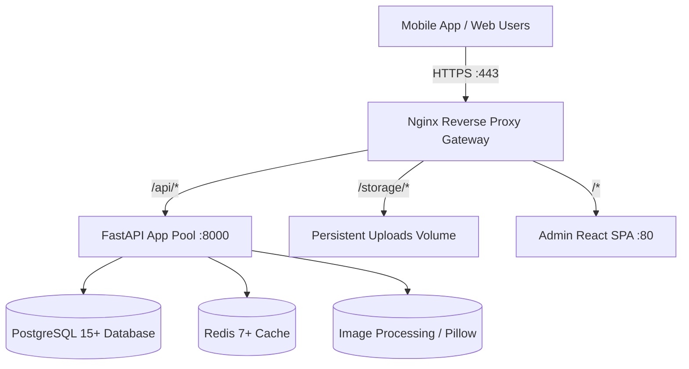

# WALLPAPERS_8K1 (W8K1) — PRODUCTION OPERATIONAL RUNBOOK

## 1. System Overview & Architecture
Wallpapers_8k1 is a high-performance commercial wallpaper delivery platform:
- **FastAPI REST API Gateway:** Python 3.11+, asynchronous I/O, Gunicorn + Uvicorn worker pool.
- **Data Persistence:** PostgreSQL 15+ with `pg_trgm` extension for typo-tolerant trigram search and GIN indexing.
- **Cache Engine:** Redis 7+ for response caching, rate limiting, and session tracking.
- **Storage Layer:** High-throughput local volume storage or S3-compatible object storage (AWS S3, Cloudflare R2, MinIO).
- **Admin Dashboard:** React 18 / TypeScript / Vite Single Page Application served via Nginx Alpine with gzip compression and immutable caching.
- **Mobile Client:** Flutter Android application with AMOLED styling, scoped storage, and Google Play Store release configuration.



---

## 2. Production Environment Setup

### 2.1 Cryptographic Key Generation
Generate cryptographically strong secrets before booting the production stack:
```bash
# Generate 64-byte hexadecimal secrets
SECRET_KEY=$(openssl rand -hex 32)
JWT_SECRET=$(openssl rand -hex 32)
```

### 2.2 Configuration File Setup
Copy the template and populate production values:
```bash
cp .env.production.example .env.production
chmod 600 .env.production
```

Key environment variables:
| Variable | Description | Recommended Setting |
|---|---|---|
| `APP_ENV` | Runtime environment | `production` |
| `APP_DEBUG` | Swagger UI & debug traces | `false` |
| `DATABASE_URL` | Async PostgreSQL connection string | `postgresql+asyncpg://...` |
| `REDIS_URL` | Redis cache connection string | `redis://redis:6379/0` |
| `ENABLE_CACHE` | Enable query response caching | `true` |
| `DB_POOL_SIZE` | SQLAlchemy connection pool | `30` |
| `DB_MAX_OVERFLOW` | Max burst connections | `15` |
| `DB_POOL_RECYCLE` | Stale connection recycle (seconds) | `1800` |
| `RATE_LIMIT_PER_MINUTE` | API rate limit | `240` |

---

## 3. Containerized Deployment (Docker Compose)

### 3.1 Deploying the Stack
```bash
# Build and launch all production containers in detached mode
docker compose -f docker-compose.prod.yml --env-file .env.production up -d --build

# Verify running container health
docker compose -f docker-compose.prod.yml ps
```

### 3.2 Running Database Migrations
```bash
# Apply Alembic migrations inside backend container
docker compose -f docker-compose.prod.yml exec backend alembic upgrade head
```

### 3.3 Database Optimization & Index Profiling
```bash
# Run PostgreSQL ANALYZE and profile query plans
docker compose -f docker-compose.prod.yml exec backend python scripts/optimize_db.py
```

---

## 4. SSL/TLS Termination with Let's Encrypt (Certbot)

To secure `api.wallpapers8k1.com` and `admin.wallpapers8k1.com`:
```bash
# Install Certbot on host
sudo apt update && sudo apt install -y certbot

# Request certificates via Standalone or Webroot
sudo certbot certonly --standalone -d api.wallpapers8k1.com -d admin.wallpapers8k1.com

# Auto-renewal via crontab
0 3 * * * certbot renew --quiet && docker compose -f /path/to/docker-compose.prod.yml restart gateway
```

---

## 5. Automated Backups & Disaster Recovery

### 5.1 Backup Scheduling (Linux Crontab)
To execute automated daily backups at 02:00 UTC and retain 7 days of rolling backups:
```bash
crontab -e
```
Add the following line:
```cron
0 2 * * * cd /opt/wallpapers8k1 && bash scripts/backup_db.sh >> /var/log/w8k1_backup.log 2>&1
```

### 5.2 Backup Execution via Python
On Windows or environments without `pg_dump`:
```powershell
python backend/scripts/backup_db.py
```

### 5.3 Disaster Recovery / Restoration Procedure
To restore a database from a `.json.gz` backup archive:
```bash
python backend/scripts/restore_db.py --archive backups/w8k1_backup_YYYYMMDD_HHMMSS.json.gz
```
Or for `.dump` files generated via `pg_dump`:
```bash
pg_restore -h localhost -p 5432 -U w8k1_prod_user -d wallpapers_8k1_prod -v -c backups/wallpapers_8k1_db_YYYYMMDD.dump
```

---

## 6. Android Google Play Store Release Guide

### 6.1 Generate Release Keystore
```bash
keytool -genkey -v -keystore upload-keystore.jks -alias w8k1_release_key \
    -keyalg RSA -keysize 2048 -validity 10000
```

### 6.2 Configure Signing Properties
Create `mobile/android/key.properties`:
```properties
storePassword=YourKeystorePassword
keyPassword=YourKeyPassword
keyAlias=w8k1_release_key
storeFile=/absolute/path/to/upload-keystore.jks
```

### 6.3 Build Production Android App Bundle (.aab)
```bash
cd mobile
flutter clean
flutter pub get
flutter build appbundle --release \
    --dart-define=APP_ENV=production \
    --dart-define=API_BASE_URL=https://api.wallpapers8k1.com/api/v1
```
The optimized, R8-shrunk, obfuscated App Bundle will be output to:
`mobile/build/app/outputs/bundle/release/app-release.aab`.

---

## 7. Health Probes & Monitoring

### 7.1 Liveness Probe
```http
GET /api/v1/health/live
```
- Status: `200 OK`
- Use for: Kubernetes `livenessProbe` and Docker `HEALTHCHECK`.

### 7.2 Readiness Probe
```http
GET /api/v1/health/ready
```
- Status: `200 OK` (when Database and Storage are writable)
- Use for: Kubernetes `readinessProbe` and Load Balancer health checks.

### 7.3 System Health Metrics
```http
GET /api/v1/health
```
- Returns detailed status of database connection, active cache provider (`redis` or `in_memory`), environment, and storage provider.
